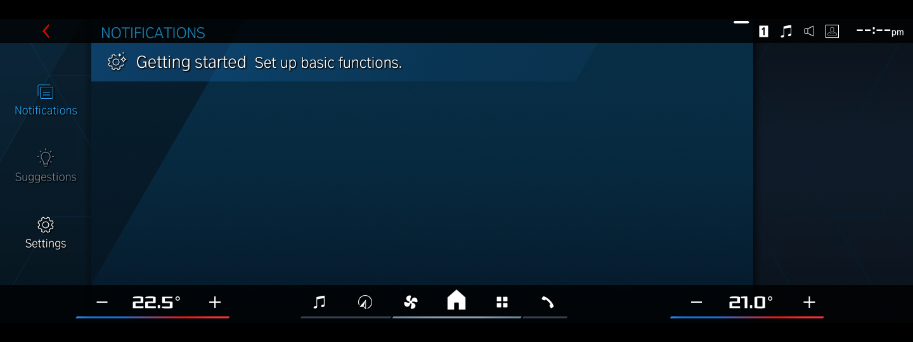

# xdrive — BMW iDrive 8.5 (MGU22) emulator

Runs the **real** BMW iDrive 8.5 head-unit software on a Windows PC. This is not a recreation:
the original aarch64 `Hmi8` binary boots under qemu in WSL2, draws through a GPU-accelerated
Weston compositor, and talks over real SOME/IP to a car simulator that stands in for the
rest of the vehicle.



> **No firmware is included.** You need your own MGU22 filesystem dump. Nothing from BMW
> is distributed in this repository.

## What works

| Feature | Status |
|---|---|
| Boot to home screen, full touch input | ✅ |
| GPU rendering (virgl → host GPU), fast boot | ✅ |
| Profiles: `xdrive` (BMW theme) and `m3` (BMW M theme, G80 LCI M3 3D car) | ✅ |
| Vehicle coding (CAFD → NCD) per profile | ✅ |
| Driver profiles | ✅ |
| Climate temperatures, +/-, A/C state | ✅ |
| Journey / trip data | ✅ |
| Check Control warnings: simulated faults (misfire, oil, tyres, …), stackable | ✅ |
| Media stack running, audio to your PC speakers | ✅ |
| My Modes, USB music, navigation, cluster, phone | 🚧 in progress |

## How it works

- **CPU:** `qemu-aarch64-static` (qemu 10) via binfmt inside a chroot built from the dump.
- **GPU:** the guest's Mesa uses `virpipe`; a native `virgl_test_server` renders on the host GPU (WSL D3D12).
- **Display & touch:** Weston ivi-shell with a custom module (`mgu-ivi-controller.c`) that places
  the HMI surfaces and turns mouse input into a uinput touchscreen. An `LD_PRELOAD` shim
  (`evdev-shim.c`) fakes the evdev ioctls qemu doesn't support.
- **Vehicle:** `carsim/` is a vsomeip application that offers the car's SOME/IP services
  (climate, check control, journey data, …), driven by `carsim.conf` and a control FIFO.
- **Coding:** `cafd.py` / `gen_coding.py` turn a readable `coding/<profile>.txt` into the NCD
  coding areas the HMI reads.
- **Audio:** ALSA `HarmanX` → PulseAudio → WSLg → Windows speakers.

## Requirements

- Windows 11 with **WSL2** and an **Ubuntu-24.04** distro (WSLg enabled).
- A GPU with working WSL D3D12 (tested on an RTX 5060).
- **Your own MGU22 filesystem dump** as a zip containing `ROOT_rootfs.zip`, `ivi_fs.zip`,
  `ext_fs.zip` and the `swfk_*` HMI data images.

## Setup

1. Clone this repo anywhere on Windows.
2. Build the rootfs from your dump (in WSL, as root):
   ```bash
   python3 -I emu/build_rootfs.py /path/to/your-mgu22-dump.zip /srv/mgu22/root
   ```
   This also copies the SWFK images to `/srv/mgu22/swfk`.
3. Fetch qemu 10 and the build toolchain:
   ```bash
   python3 -I emu/fetch_qemu.py
   ```
   ```bash
   apt install weston virgl-server gcc-aarch64-linux-gnu g++-aarch64-linux-gnu python3
   ```
4. Start it from PowerShell in `emu\`:
   ```powershell
   .\start.ps1 m3
   ```
   The "Weston Compositor" window is the car's centre display. Click or drag in it to touch.

## Using it

```powershell
.\start.ps1 -List            # available profiles
.\start.ps1 m3               # M3 G80 LCI
.\stop.ps1                   # stop everything
.\warn.ps1 misfire oil       # add Check Control warnings (they stack)
.\warn.ps1 remove oil        # remove one
.\warn.ps1 active            # what's active
.\warn.ps1 clear             # remove all
.\carsim\sim.ps1 dump        # show what the car simulator is publishing
```

## Repository layout

```
emu/            launcher, setup, compositor module, shims, coding tools
emu/carsim/     SOME/IP car simulator + config
emu/audio/      media stack + audio routing
emu/coding/     per-profile vehicle coding
emu/profiles/   per-profile settings (brand, variant, screen size)
screenshots/    captures from the running emulator
```

## Disclaimer

Independent hobby project, not affiliated with or endorsed by BMW AG. BMW, iDrive and M are
trademarks of BMW AG. Bring your own legally obtained firmware.

